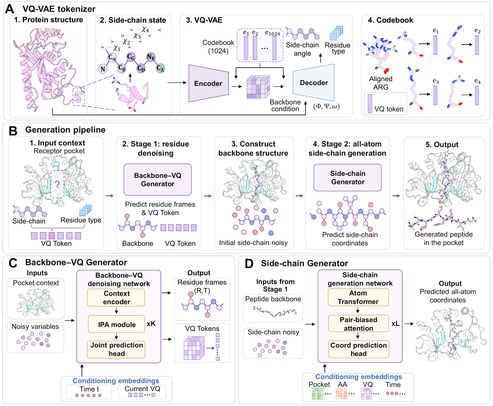

# PepFloken

**Target-conditioned All-Atom Peptide Design through Discrete Side-Chain Conformation Tokenization and Multi-modal Flow Matching**




## Installation

Run these commands from the repository root with Conda installed. [environment.yml](environment.yml) installs Python 3.11, PyTorch 2.14.1 with CUDA 13.2, and the project dependencies. Use an NVIDIA GPU with a CUDA 13.2-compatible driver. 
```bash
conda env create -f environment.yml
conda activate pepfloken
```

## Data

PepFloken uses peptide–protein complex data from PepGLAD. Build the splits by selecting structures from the upstream archives using the sample IDs in [pretrain_data.txt](pretrain_data.txt), [train_data.txt](train_data.txt), [val_data.txt](val_data.txt), and [test_data.txt](test_data.txt), then preprocess the selected peptide and receptor-pocket structures into PepFloken LMDB caches. The packaged caches have their own record IDs and counts. The sampling command uses the records in the demo cache. [PepGLAD](https://github.com/THUNLP-MT/PepGLAD) · [Upstream data archives](https://zenodo.org/records/13373108)

## Train

Prepare `Data/pretrain_data.lmdb` using [pretrain_data.txt](pretrain_data.txt). The second stage uses the bundled `Data/train.lmdb` and `Data/val.lmdb`. Run training on Linux or GPU-enabled WSL2 with NCCL. Pretrain first with `pretrain.yaml`, then initialize two-stage training with the saved weights using `--continuepath`. Choose either launcher below.

The default configurations save every 20,000 steps and replace the previous checkpoint for that run. With the run names below, pretraining saves to `result/pretrain/Pepfloken_pre.pt` and the second stage saves to `result/twosteps/Pepfloken.pt`. Start the second stage after the pretraining checkpoint has been saved.

### With `torchrun`

```bash
mkdir -p result
torchrun --standalone --nproc_per_node=1 train_pre.py --config configs/pretrain.yaml --name pretrain
torchrun --standalone --nproc_per_node=1 train_twosteps.py --config configs/train.yaml --name twosteps --continuepath result/pretrain/Pepfloken_pre.pt
```

### With `python`

```bash
mkdir -p result
python -m torch.distributed.run --standalone --nproc_per_node=1 train_pre.py --config configs/pretrain.yaml --name pretrain
python -m torch.distributed.run --standalone --nproc_per_node=1 train_twosteps.py --config configs/train.yaml --name twosteps --continuepath result/pretrain/Pepfloken_pre.pt
```

## Sample

The default `configs/train.yaml` configuration loads `ckpt/pepfloken.pt` and `Data/test.lmdb`. The command below generates one sample per test example on the first GPU.
```unrar
unrar ./ckpt/pepfloken.rar
```
```bash
python sample_twostep.py --num_samples 1 --batch_size 1
```
Generated PDBs are written to `result/pepfloken/sample/`. Use `--ckpt result/twosteps/Pepfloken.pt` to sample with your trained weights and `--config` to select a different dataset configuration.
